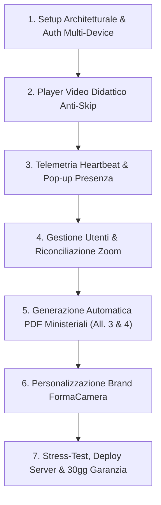

# PREVENTIVO DI FORNITURA SOFTWARE & PIANO DETTAGLIATO DELLE ATTIVITÀ
## Piattaforma E-Learning FAD White-Label Conforme alle Linee Guida B (Ministero del Turismo)

---

**Rif. Documento:** PREV-2026/FORMACAMERA-FAD-01  
**Data di Emissione:** 19 Ottobre 2026  
**Validità Offerta:** 30 giorni  
**Committente:** Spett.le **FormaCamera — Azienda Speciale della Camera di Commercio di Roma**  
**Cortese Attenzione:** **Dott.ssa Paola Scamardi**  
**Fornitore / Sviluppatore:** Dario — Consulente Sviluppo Web & Software Freelance  
**Oggetto:** Sviluppo, configurazione architetturale, personalizzazione grafica, collaudo e fornitura chiavi in mano della Piattaforma Web E-Learning FAD proprietaria per l'erogazione dei Corsi di Aggiornamento per Guide Turistiche ai sensi della Legge 13 dicembre 2023, n. 190 e del D.M. 26 giugno 2024, n. 88 (Linee Guida B — Allegati 3 e 4).

---

> [!IMPORTANT]
> ### QUADRO ECONOMICO DI SINTESI & CONDIZIONI INFRASTRUTTURALI
> * **PREZZO FINALE DELLA FORNITURA A CORPO:** **€ 2.500,00 (Duemilacinquecento/00) — IVA INCLUSA**  
>   *(Compenso forfettario omnicomprensivo "chiavi in mano" per lo sviluppo software, licenza d'uso proprietaria senza canoni periodici per corsista, codice sorgente completo e supporto al rilascio).*
> * **INFRASTRUTTURA SERVER E DOMINIO A TOTALE CARICO DI FORMACAMERA:**  
>   **Tutti i costi vivi relativi al server di hosting/VPS (o cloud instance), alla banda di trasmissione dati, allo spazio di archiviazione dei video e alla registrazione/mantenimento annuale del nome a dominio sono ad esclusivo carico di FormaCamera.**  
>   Lo sviluppatore fornirà gratuitamente l'assistenza tecnica sistemistica per la prima configurazione, il deploy e la messa in produzione della piattaforma sull'infrastruttura scelta dall'Ente.

---

## 1. Relazione Generale & Spiegazione Unica del Lavoro da Fare

La presente proposta prevede la realizzazione di un software web FAD (**Formazione a Distanza**) progettato su misura per **FormaCamera di Roma**, con l'obiettivo di rispondere in modo puntuale e rigoroso a tutti gli adempimenti didattici e legali stabiliti dalle **Linee Guida B del Ministero del Turismo** per i corsi di aggiornamento professionale delle guide turistiche.

La piattaforma risolve l'intero flusso operativo dell'Ente attraverso una soluzione tecnologica integrata:

1. **Gestione del Modello Didattico Ibrido (20h Zoom Sincrone + 5h FAD Asincrone) o 100% Piattaforma:**  
   Il software consente di gestire corsi strutturati su 25 ore complessive (20 ore di lezioni in diretta videoconferenza su Zoom e 5 ore di approfondimenti asincroni videoregistrati, suddivisi in 5 moduli da 1 ora). La segreteria carica semplicemente il report delle presenze esportato da Zoom: la piattaforma lo acquisisce in un istante e lo riconcilia con i minuti maturati dai corsisti nelle videolezioni interne, calcolando automaticamente il raggiungimento della **soglia minima dell'80%** (Art. 6 Linee Guida B). Inoltre, uno switch dedicato permette di disattivare le ore Zoom per erogare seminari o corsi monografici interamente asincroni.

2. **Player Didattico con Tecnologia Anti-Skip ad Alta Garanzia:**  
   A tutela di FormaCamera contro contestazioni in sede di audit ministeriale, il player multimediale inibisce qualsiasi tentativo di elusione dei tempi formativi. La barra di avanzamento temporale (*seekbar*) è bloccata: l'allievo può riavvolgere per riascoltare un passaggio, ma non può avanzare artificialmente in avanti. La velocità è vincolata a `1.0x` (senza accelerazioni) e, qualora l'utente cambi scheda del browser o riduca la finestra a icona, la riproduzione e il conteggio del tempo si arrestano istantaneamente (`strict_tab_pause`).

3. **Telemetria Immutabile & Pop-up di Verifica Presenza Attiva:**  
   Il browser invia un battito cardiaco (*heartbeat*) cifrato al server ogni 5 secondi, registrando solo i secondi di effettiva visualizzazione a schermo. Ad intervalli casuali o prefissati compaiono finestre pop-up con un conto alla rovescia di 60 secondi che richiedono una conferma attiva: in caso di allontanamento dell'utente, il video si interrompe e il tempo non viene contato. Ogni evento (orario al secondo, indirizzo IP, User-Agent, download dispense) viene memorizzato a database in un registro immutabile.

4. **Accessi Riservati con Codice Invito (Nessun Catalogo Pubblico):**  
   Per garantire la massima riservatezza e prevenire iscrizioni estranee, la piattaforma non espone alcun catalogo pubblico di corsi. I corsisti possono registrarsi e agganciarsi a un corso esclusivamente tramite un **Codice Invito Segreto** (es. `INV-GT2026`) comunicato direttamente dalla Segreteria di FormaCamera, oppure tramite assegnazione diretta da pannello amministratore. Il sistema include inoltre un recupero password autonomo a doppio canale (via email con link temporaneo firmato oppure verifica istantanea tramite Codice Fiscale).

5. **Automazione Totale delle Certificazioni e dei Registri Ministeriali:**  
   Al superamento dell'80% delle ore di frequenza complessiva, il sistema abilita automaticamente il download dell'**Attestato Ufficiale di Frequenza (Allegato 4 — Linee Guida B)** compilato in PDF vettoriale ad alta definizione con anagrafica, codice fiscale, numero di iscrizione all'Elenco Nazionale, codici ATECO 79.90 / CP ISTAT 3.4.1.5.2 e **QR Code SVG dinamico** per la verifica immediata online dell'autenticità. Vengono inoltre prodotti la Scheda Corso (**Allegato 3**), il Registro Presenze del Corso (PDF + CSV per l'invio via PEC al Ministero) e il Fascicolo Probante Telemetrico individuale.

6. **Identità Grafica Istituzionale FormaCamera (White-Label):**  
   La piattaforma viene consegnata completamente brandizzata con il Logo e la denominazione di **FormaCamera — Camera di Commercio di Roma**, con palette cromatica coordinata, modalità "Solo Logo" nell'intestazione e nel login, e calcolo automatico del contrasto del testo secondo gli standard di accessibilità WCAG.

---

## 2. Dettaglio Analitico del Lavoro da Fare (Piano delle Attività)

Tutte le seguenti attività e funzionalità sono incluse nell'importo unico a corpo di **€ 2.500,00 IVA inclusa**:



### Area 1 — Setup Architetturale, Database Relazionale & Autenticazione Riservata
* Installazione e configurazione dell'ambiente applicativo con framework **Laravel 12 (PHP 8.2+)**.
* Progettazione dello schema database relazionale (MySQL/MariaDB) con tabelle dedicate per corsi, edizioni, moduli video, materiali allegati, corsisti, log telemetrici e sessioni di frequenza.
* Pagina di login brandizzata FormaCamera con blocco degli accessi simultanei con le medesime credenziali da postazioni diverse.
* Modulo di auto-registrazione senza catalogo pubblico: associazione ai corsi esclusivamente tramite **Codice Invito Segreto** o assegnazione diretta da parte della Segreteria.
* Sistema di recupero password a doppio canale:
  * Invio email automatica con link firmato crittograficamente e token temporaneo.
  * Verifica immediata dell'identità tramite riscontro di Indirizzo Email e Codice Fiscale.

### Area 2 — Motore Didattico Ibrido (Zoom + FAD) & Player Video Anti-Skip
* Gestione completa dei corsi composti da **1 a N moduli formativi**, ciascuno corredato da titolo, docente, stima oraria, video didattico e dispense PDF scaricabili.
* **Switch Ore Sincrone Zoom ON/OFF**: configurazione per alternare la modalità ibrida (20h Zoom + 5h FAD) alla modalità 100% asincrona interna.
* **Player Video Interattivo Alpine.js**:
  * Compatibilità con file `.MP4` nativi e video **YouTube con Schermatura "No-Logo Shield"** (rimozione totale di loghi, link esterni a YouTube e video correlati).
  * **Blocco dell'avanzamento rapido (Anti-Skip)**: barra di avanzamento bloccata; consentito solo il riavvolgimento nelle parti già viste.
  * **Blocco velocità a 1.0x**: inibizione dell'accelerazione artificiosa dei contenuti.
  * **Pausa automatica al cambio scheda (`tab_blur_pause`)**: arresto immediato del video e del conteggio dei secondi in caso di cambio finestra o minimizzazione del browser.
  * **Segnalibro di ripresa automatica**: salvataggio continuo al secondo esatto per riprendere la visione su qualsiasi dispositivo.

### Area 3 — Telemetria Heartbeat, Controllo Presenza Attiva & Registro Audit
* Meccanismo di telemetria continuo (*heartbeat*) ogni 5 secondi tra browser e backend per il salvataggio dei secondi effettivi di visione a schermo.
* **Finestre Pop-up di Verifica Presenza**: comparse periodiche a intervalli configurabili (10-30 minuti) con conto alla rovescia di 60 secondi per confermare la presenza attiva; sospensione immediata del video in caso di mancata risposta.
* Registro immutabile a database con data, ora esatta, indirizzo IP, User-Agent, cambi di scheda e download delle dispense.
* Stampa ed esportazione del Fascicolo Probante Telemetrico per ciascun allievo, a garanzia dell'Ente contro contenziosi o ispezioni.

### Area 4 — Gestione Utenti, Iscrizioni & Riconciliazione Presenze Zoom
* Cruscotto per la Segreteria Didattica con tabella riassuntiva di tutti gli allievi iscritti, avanzamento per modulo e stato di idoneità all'attestato.
* **Importatore Massivo Corsisti**: caricamento facilitato tramite file CSV/Excel preformattato.
* **Importatore Report Zoom**: caricamento con un click del foglio presenze di Zoom per l'assegnazione automatica delle 20 ore sincrone (o delle ore parziali effettive) a ciascun allievo.
* Riconciliazione in tempo reale: somma automatica tra ore Zoom e ore FAD, con verifica istantanea del superamento della **soglia dell'80%** (20 ore totali su 25).
* Funzionalità di sospensione o disattivazione rapida di corsisti o corsi con blocco istantaneo degli accessi e salvaguardia di tutto lo storico pregresso.

### Area 5 — Certificazioni Ufficiali Ministeriali PDF & Documentazione Probante
* Compilazione ed emissione automatica in formato PDF vettoriale ad alta definizione conforme alle direttive delle Linee Guida B:
  1. **Attestato di Frequenza Ufficiale (Allegato 4 — Linee Guida B)**: anagrafica, codice fiscale, numero di iscrizione Elenco Nazionale, codice ATECO 79.90, CP ISTAT 3.4.1.5.2, ore certificate, data di rilascio, timbro FormaCamera e **QR Code SVG** di verifica immediata online.
  2. **Scheda Progettazione Corso (Allegato 3 — Linee Guida B)**: prospetto didattico ufficiale con indicazione dei moduli, docenti e ore.
  3. **Registro Presenze Consolidato del Corso**: tabulato generale sia in PDF stampabile sia in formato Excel/CSV per la trasmissione via PEC al Ministero del Turismo (`piattaformaguide@pec.ministeroturismo.gov.it`).
  4. **Fascicolo Probante Individuale**: estratto dettagliato di tutti i log di fruizione e controlli presenza dell'allievo.
* Download condizionato: l'allievo può scaricare l'attestato solo al raggiungimento della soglia minima dell'80%.

### Area 6 — Personalizzazione Grafica White-Label Istituzionale FormaCamera
* Configurazione dell'identità visiva con Logo ufficiale di **FormaCamera — Camera di Commercio di Roma**.
* Opzione "Solo Logo" per un'intestazione pulita, autorevole ed elegante nella barra superiore e nella pagina di login.
* Palette cromatica istituzionale (Blu Camera di Commercio) con calcolo automatico del contrasto del testo per la piena rispondenza ai criteri di accessibilità WCAG.

### Area 7 — Stress-Test (80-100 Utenti), Deploy su Server FormaCamera & Garanzia Post-Rilascio
* Simulazione e test di carico per accertare la stabilità operativa con 80–100 accessi contemporanei in streaming e telemetria attiva.
* Configurazione dello stack PHP, database e certificato di sicurezza SSL HTTPS sull'infrastruttura server messa a disposizione da FormaCamera.
* Sessione remota di collaudo e formazione operativa per il personale di segreteria di FormaCamera.
* **30 giorni di garanzia e assistenza tecnica inclusi** dal giorno del rilascio, per la risoluzione prioritaria di eventuali anomalie o bug fixing.

---

## 3. Quadro Economico Riepilogativo

```
╔══════════════════════════════════════════════════════════════════════════════════════════╗
║  DESCRIZIONE FORNITURA                                                                   ║
║  Sviluppo, personalizzazione grafica istituzionale FormaCamera, configurazione           ║
║  architetturale, automazione attestati ministeriali (Allegato 4 con QR Code),            ║
║  player anti-skip, telemetria, import Zoom, collaudo e fornitura chiavi in mano         ║
║  della Piattaforma E-Learning FAD per Guide Turistiche.                                  ║
║                                                                                          ║
║  • Nessun canone periodico per corsista o per corso (Licenza d'Uso Proprietaria)        ║
║  • Codice sorgente completo e documentato                                                ║
║  • Assistenza al deploy sul server dell'Ente e 30 giorni di garanzia post-rilascio       ║
╠══════════════════════════════════════════════════════════════════════════════════════════╣
║  TOTALE COMPLESSIVO A CORPO:                               € 2.500,00                    ║
║  IVA / REGIME FISCALE:                                     INCLUSA                       ║
║  IMPORTO FINALE DOVUTO:                                    € 2.500,00                    ║
╚══════════════════════════════════════════════════════════════════════════════════════════╝
```

---

## 4. Modalità di Pagamento e Condizioni Contrattuali

1. **Scaglioni di Pagamento**:
   * **40% (€ 1.000,00 IVA inclusa)** a titolo di acconto all'accettazione del preventivo e avvio dei lavori.
   * **30% (€ 750,00 IVA inclusa)** al rilascio della versione **Beta funzionante** in ambiente di prova per i test della Segreteria.
   * **30% (€ 750,00 IVA inclusa)** a saldo finale, a conclusione del collaudo e avvenuto deploy in produzione.
2. **Proprietà del Software e Assenza di Canoni**:
   * Il software viene fornito a FormaCamera con **licenza d'uso proprietaria senza limiti sul numero di corsi, moduli, corsisti o attestati emessi**. FormaCamera potrà utilizzare la piattaforma liberamente nel tempo per tutti i corsi futuri senza dover corrispondere alcuna royalty allo sviluppatore.
3. **Esclusioni Esplicite**:
   * I costi vivi per server/VPS, connettività, storage cloud per i video e registrazione/rinnovo del dominio web restano a carico di FormaCamera.
4. **Tempi di Realizzazione e Consegna**:
   * Versione Beta funzionante per verifica interna: entro **10 giorni lavorativi** dall'acconto.
   * Rilascio definitivo in produzione: entro **15-20 giorni solari** dall'avvio dei lavori.

---

Per accettazione e conferma d'ordine:

**Per FormaCamera (Il Committente)**  
*Dott.ssa Paola Scamardi*  
_____________________________________  
*(Data, Timbro e Firma del Legale Rappresentante)*  

**Il Fornitore / Sviluppatore**  
*Dario — Consulente Sviluppo Software*
