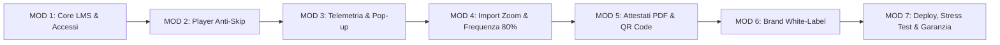

# PREVENTIVO DI FORNITURA SOFTWARE & CAPITOLATO ECONOMICO DETTAGLIATO
## Piattaforma E-Learning FAD White-Label Conforme alle Linee Guida B (Ministero del Turismo)

---

**Rif. Documento:** PREV-2026/FORMACAMERA-FAD-01  
**Data di Emissione:** 19 Ottobre 2026  
**Validità Offerta:** 30 giorni  
**Committente:** Spett.le **FormaCamera — Azienda Speciale della Camera di Commercio di Roma**  
**Cortese Attenzione:** Dott.ssa Paola Gentile  
**Fornitore / Sviluppatore:** Dario — Consulente Sviluppo Web & Software Freelance  
**Oggetto:** Sviluppo, personalizzazione grafica, collaudo e fornitura chiavi in mano della Piattaforma E-Learning FAD proprietaria per l'erogazione dei Corsi di Aggiornamento per Guide Turistiche ai sensi della Legge 13 dicembre 2023, n. 190 e del D.M. 26 giugno 2024, n. 88 (Linee Guida B — Allegati 3 e 4).

---

> [!IMPORTANT]
> ### QUADRO ECONOMICO DI SINTESI & CLAUSOLA INFRASTRUTTURA
> * **PREZZO FINALE DELLA FORNITURA:** **€ 2.500,00 (Duemilacinquecento/00) — IVA INCLUSA** *(Prezzo forfettario a corpo "chiavi in mano" per licenza software proprietaria, codice sorgente completo e messa in opera).*
> * **INFRASTRUTTURA SERVER E DOMINIO A CARICO DEL COMMITTENTE:**  
>   **Tutti i costi vivi relativi al server di hosting/VPS (o cloud instance), alla banda di trasmissione dati, allo spazio di archiviazione per i video e alla registrazione/mantenimento annuale del nome a dominio sono ad esclusivo carico di FormaCamera.**  
>   Lo sviluppatore fornirà gratuitamente l'assistenza tecnica sistemistica per la prima configurazione, il deploy e la messa in produzione della piattaforma sull'infrastruttura prescelta dall'Ente.

---

## 1. Relazione Generale & Spiegazione Unica del Progetto

La presente fornitura ha come obiettivo la realizzazione di un software web FAD (**Formazione a Distanza**) appositamente concepito per rispondere a tutti i rigidi adempimenti normativi previsti dalle **Linee Guida B del Ministero del Turismo** per i corsi di aggiornamento e specializzazione delle guide turistiche iscritte all'Elenco Nazionale.

La piattaforma risolve le criticità organizzative e legali della formazione a distanza tramite un'architettura integrata che combina:
1. **Didattica Flessibile Ibrida (20h Zoom Sincrone + 5h FAD Asincrone)** o **100% Asincrona in Piattaforma**: l'ente può impostare per ciascun corso se le ore sincrone su Zoom siano abilitate oppure disattivate, consentendo di erogare sia percorsi complessi da 25 ore (20h videoconferenza + 5h moduli video registrati) sia seminari monografici fruibili interamente online.
2. **Player Video Anti-Skip ad Alta Sicurezza**: visualizzatore multimediale (compatibile con file MP4 e video YouTube mascherati in modalità "No-Logo Shield") che inibisce l'avanzamento rapido, impedisce l'elusione dei tempi formativi e sospende automaticamente il computo orario qualora il corsista minimizzi il browser o cambi scheda.
3. **Telemetria Immutabile & Controllo Presenza Attiva**: battito cardiaco (*heartbeat*) salvato a database ogni 5 secondi, tracciamento degli indirizzi IP e pop-up interattivi casuali di conferma presenza per garantire la conformità ad ogni eventuale audit o ispezione ministeriale.
4. **Automazione Totale delle Certificazioni e dei Registri**: al raggiungimento della soglia minima dell'80% di frequenza certificata (Art. 6 Linee Guida B), la piattaforma compila ed emette automaticamente l'**Attestato di Frequenza Ufficiale (Allegato 4)** con **QR Code SVG** di verifica autenticità, generando al contempo la Scheda Corso (**Allegato 3**), il Registro Presenze Consolidato e il Fascicolo Probante Telemetrico.

---

## 2. Computo Metrico Analitico delle Attività (WBS)

Il prezzo a corpo di **€ 2.500,00 IVA inclusa** comprende l'intera esecuzione delle seguenti 7 aree progettuali:

### MOD-01: Architettura Core LMS, Autenticazione & Aggancio Corsi con Codice Segreto
* Configurazione ambiente applicativo basato su **Laravel 12 (PHP 8.2+)** con database relazionale ottimizzato (MySQL / MariaDB).
* Login brandizzato con logo istituzionale FormaCamera e blocco degli accessi simultanei con le medesime credenziali da postazioni diverse.
* **Auto-registrazione controllata senza catalogo pubblico**: gli utenti esterni non possono visualizzare l'elenco dei corsi dell'ente. L'accesso a un corso avviene esclusivamente tramite **Codice Invito Segreto** (es. `INV-GT2026`) generato dalla Segreteria ed inserito in fase di registrazione o dalla Dashboard Corsista.
* **Sistema di recupero password a doppio canale**:
  * Canale 1: Invio email automatica con link firmato e token di reimpostazione temporaneo crittografato.
  * Canale 2: Verifica immediata dell'identità tramite abbinamento univoco di Indirizzo Email e Codice Fiscale.
* *Valore economico di computo: € 400,00*

### MOD-02: Motore Corsi Flessibile & Player Video Didattico Anti-Skip
* Pannello per la creazione di corsi composti da **1 a N moduli formativi** (ciascun modulo con durata stimata, docente, video e dispense PDF allegate).
* **Switch Ore Sincrone Zoom ON/OFF**: configurazione che consente di alternare la modalità ibrida (somma di 20h Zoom + 5h FAD) alla modalità 100% piattaforma (calcolo basato solo sui moduli video).
* **Player Video Avanzato Alpine.js**:
  * Supporto per file video `.MP4` nativi e per video **YouTube con Schermatura "No-Logo Shield"** (rimozione di loghi, link a canali esterni e video correlati).
  * **Protezione Anti-Skip rigorosa**: la barra di avanzamento temporale è bloccata; l'utente può riavvolgere per rivedere una spiegazione, ma non può avanzare oltre il secondo massimo effettivamente visto.
  * **Blocco velocità riproduzione**: forzata a `1.0x` per impedire l'accelerazione dei video.
  * **Pausa automatica al cambio scheda (`tab_blur_pause`)**: se il corsista apre un'altra finestra o riduce il browser a icona, il video va istantaneamente in pausa e il tempo si blocca.
  * **Segnalibro di ripresa automatica**: salvataggio al secondo esatto per riprendere la visione su qualsiasi dispositivo.
* *Valore economico di computo: € 650,00*

### MOD-03: Telemetria Heartbeat, Controllo Presenza Attiva & Registro Audit
* Meccanismo di salvataggio continuo ogni 5 secondi (*heartbeat*) sul server dei secondi reali trascorsi sul video.
* **Pop-up di verifica presenza attiva**: comparsa a video a intervalli regolari o casuali (configurabili da 10 a 30 minuti) con richiesta di clic entro un conto alla rovescia di 60 secondi. In caso di mancata risposta, il video si interrompe e il tempo si blocca.
* Storicizzazione immutabile di ogni evento a database: data, ora esatta, indirizzo IP, User-Agent del browser, cambi di scheda e conferme di presenza.
* Registro audit completo esportabile in PDF a prova di contestazione ispettiva ministeriale.
* *Valore economico di computo: € 400,00*

### MOD-04: Gestione Utenti, Iscrizioni, Importazione CSV e Riconciliazione Presenze Zoom
* Cruscotto segreteria didattica con tabella riassuntiva di tutti gli iscritti, stato di avanzamento per modulo e stato di idoneità all'attestato.
* **Importatore Massivo di elenchi corsisti** tramite file CSV/Excel preformattato.
* **Importatore Report Zoom**: caricamento del file presenze esportato da Zoom per valorizzare automaticamente le 20 ore di lezione sincrona svolte da ciascun allievo.
* Calcolo automatico in tempo reale del superamento della **soglia dell'80%** (20 ore su 25 complessive) per il conseguimento del titolo di frequenza.
* Possibilità di sospendere o disattivare un singolo corsista o un intero corso con revoca immediata delle credenziali senza perdita dei dati storici.
* *Valore economico di computo: € 350,00*

### MOD-05: Certificazioni Ufficiali PDF Ministeriali & Documenti Probanti
* Motore di generazione PDF vettoriali per la stampa ad alta risoluzione:
  1. **Attestato di Frequenza Ufficiale (Allegato 4 — Linee Guida B)**: compilato automaticamente con anagrafica, codice fiscale, numero iscrizione Elenco Nazionale, codice ATECO 79.90, CP ISTAT 3.4.1.5.2, ore effettive svolte e **QR Code SVG** univoco per la verifica online dell'autenticità del certificato.
  2. **Scheda Progettazione Corso (Allegato 3 — Linee Guida B)**: riepilogo formativo dei moduli, dei docenti e delle ore.
  3. **Registro Presenze Consolidato**: foglio presenze ufficiale del corso sia in PDF stampabile sia in formato tabellare Excel/CSV per gli invii via PEC al Ministero (`piattaformaguide@pec.ministeroturismo.gov.it`).
  4. **Fascicolo Probante Individuale del Corsista**: estratto dettagliato di tutti i log di accesso, secondi di fruizione, verifiche presenza e download dispense.
* Sblocco condizionato: l'attestato diventa scaricabile dal corsista solo e soltanto quando la percentuale di frequenza raggiunge o supera l'80%.
* *Valore economico di computo: € 400,00*

### MOD-06: Personalizzazione White-Label & Brand Identity FormaCamera
* Modulo amministrativo dedicato per l'adattamento visivo all'identità istituzionale di FormaCamera:
  * Caricamento logo istituzionale ad alta definizione con opzione *"Mostra Solo Logo"* nell'intestazione e nella schermata di login.
  * Palette cromatica personalizzata: colori primario, secondario e accento (preimpostato sul preset istituzionale Blu Camera di Commercio).
  * Algoritmo automatico di calcolo del contrasto del testo (conformità WCAG) per garantire la massima leggibilità su tutti gli sfondi.
* *Valore economico di computo: € 150,00*

### MOD-07: Collaudo, Stress-Test (80-100 Utenti), Deploy Server & Garanzia Post-Rilascio
* Simulazione e stress-test di carico per garantire la stabilità con oltre 80–100 accessi contemporanei in streaming e telemetria attiva.
* Configurazione sistemistica dello stack PHP, database e certificato SSL HTTPS sul server messo a disposizione da FormaCamera.
* Sessione remota di collaudo e formazione per il personale di segreteria FormaCamera.
* **30 giorni di garanzia e assistenza tecnica inclusi** a partire dalla data di rilascio, per la risoluzione prioritaria di qualsiasi anomalia o malfunzionamento.
* *Valore economico di computo: € 150,00*

---

## 3. Tabella Riepilogativa del Quadro Economico

| Codice | Descrizione Modulo di Lavoro | Tempo Stimato | Importo |
| :---: | :--- | :---: | :---: |
| **MOD-01** | Core LMS, Autenticazione Multi-Device, Reset Password & Codici Segreti | 2,5 gg | € 400,00 |
| **MOD-02** | Motore Corsi Sincrono/Asincrono, Player Anti-Skip & Shield YouTube | 3,5 gg | € 650,00 |
| **MOD-03** | Telemetria Heartbeat (5s), Pop-up Presenza & Registro Audit | 2,0 gg | € 400,00 |
| **MOD-04** | Gestione Utenti, Import CSV Corsisti & Riconciliazione Ore Zoom | 2,0 gg | € 350,00 |
| **MOD-05** | Generazione Automatica PDF Ministeriali (All. 3, All. 4 con QR Code) | 2,5 gg | € 400,00 |
| **MOD-06** | Personalizzazione White-Label Istituzionale FormaCamera | 1,0 gg | € 150,00 |
| **MOD-07** | Stress-Test (80-100 utenti), Messa in Produzione & 30gg Garanzia | 1,5 gg | € 150,00 |
| **TOTALE** | **TOTALE COMPLESSIVO FORNITURA CHIAVI IN MANO** | **15 gg lav.** | **€ 2.500,00** |
| | **IVA / Regime Fiscale** | | **INCLUSA** |
| | **IMPORTO FINALE DOVUTO DAL COMMITTENTE** | | **€ 2.500,00** |

---

## 4. Modalità di Pagamento e Condizioni Contrattuali

1. **Scaglioni di Pagamento**:
   * **40% (€ 1.000,00 IVA inclusa)** a titolo di acconto all'accettazione del preventivo e avvio lavori.
   * **30% (€ 750,00 IVA inclusa)** al rilascio della versione **Beta funzionante** in ambiente di prova per i test della segreteria.
   * **30% (€ 750,00 IVA inclusa)** a saldo finale, a conclusione del collaudo e avvenuto deploy in produzione.
2. **Proprietà del Codice e Assenza di Canoni**:
   * La piattaforma viene rilasciata a FormaCamera con **licenza d'uso proprietaria senza canoni ricorrenti per utente o per corso**. FormaCamera è libera di erogare un numero illimitato di edizioni, corsi ed attestati nel tempo.
3. **Esclusioni Esplicite**:
   * Come sopra specificato, i costi relativi ai canoni server/hosting, connettività, storage dati/video e acquisto/rinnovo del dominio restano a carico di FormaCamera.
4. **Tempi di Realizzazione**:
   * Versione Beta per collaudo: entro **10 giorni lavorativi** dall'acconto.
   * Rilascio definitivo in produzione: entro **15-20 giorni solari** dall'avvio.

---

Per accettazione del presente preventivo:

**Per FormaCamera (Il Committente)**  
_____________________________________  
*(Data, Timbro e Firma del Legale Rappresentante)*  

**Il Fornitore / Sviluppatore**  
*Dario — Consulente Sviluppo Software*
