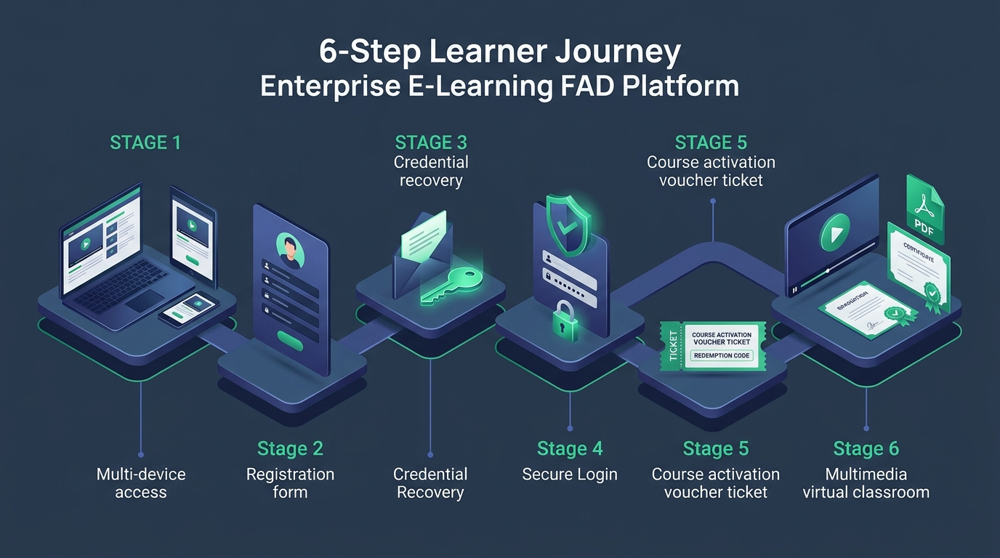
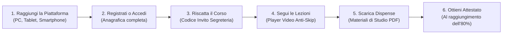
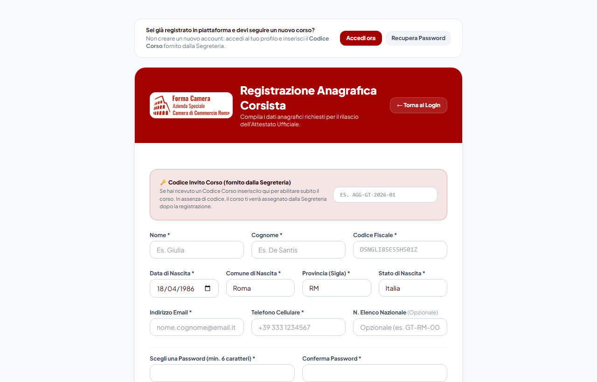
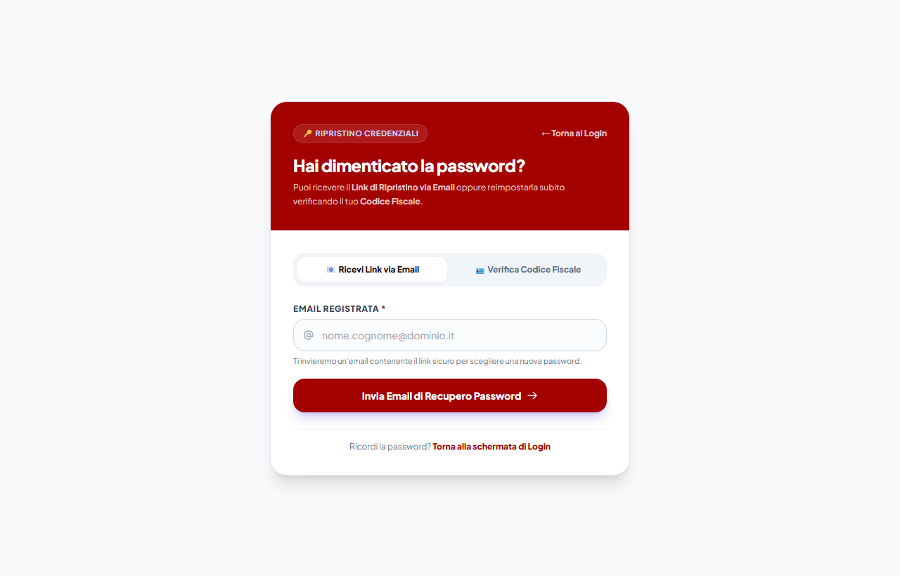
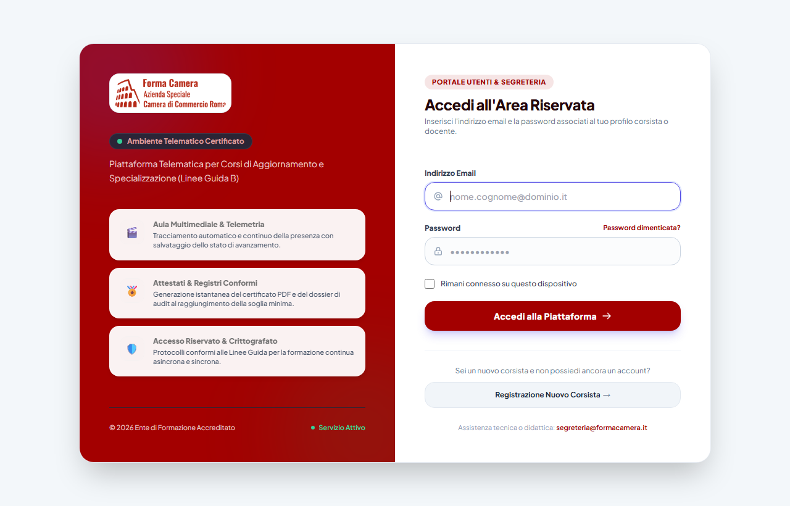
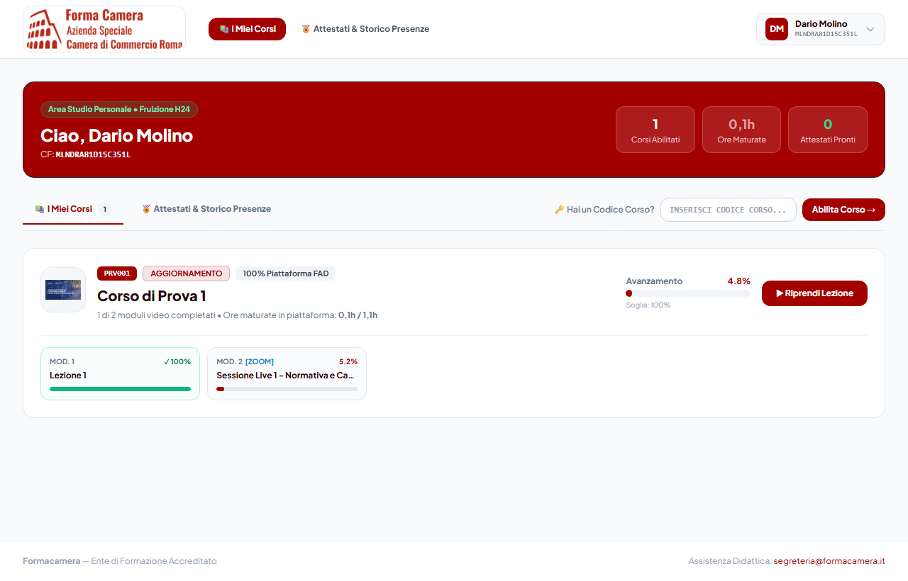
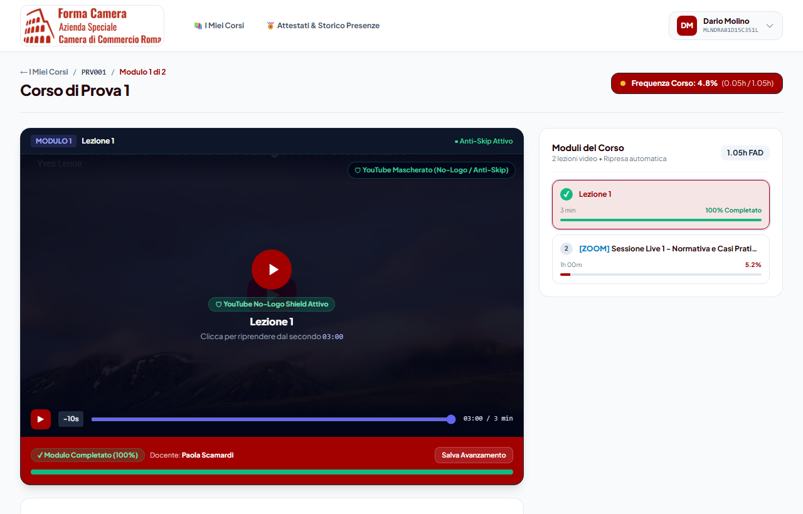

# 📘 Guida Utente & FAQ — Piattaforma FAD / LMS
### Manuale Operativo con Schermate Reali per il Corsista

---

## 🧭 Panoramica Rapida del Percorso Corsista

---

## ❓ FAQ & Istruzioni Dettagliate Passo-Passo

### 1. Come raggiungere la piattaforma?

> [!NOTE] Requisiti Tecnici Minimi
> Non è richiesta l'installazione di alcun software o applicazione. La piattaforma è accessibile tramite qualsiasi browser web moderno (**Google Chrome**, **Mozilla Firefox**, **Apple Safari**, **Microsoft Edge**) aggiornato.

* **Da dove accedere:** Puoi collegarti indistintamente da Computer (PC Windows, Mac, Linux), Tablet (iPad, Android) o Smartphone.
* **Indirizzo Web:** Digita o incolla l'URL fornito dalla Segreteria Didattica nella barra degli indirizzi del tuo browser (es. `https://fad.nomeente.it` o il link comunicato via email).
* **Consiglio Pratico:** Salva l'indirizzo tra i **Preferiti** o segnalibri del tuo browser per ritrovarlo facilmente ogni volta che desideri continuare il tuo studio.

---

### 2. Come registrarsi?

Se partecipi per la prima volta e non possiedi ancora un account:

1. **Raggiungi la pagina di registrazione:**
   Dalla schermata iniziale di login, clicca sul pulsante **"Registrazione Nuovo Corsista &rarr;"** (oppure vai direttamente all'indirizzo `/register`).
2. **Inserisci il Codice Invito Corso (se disponibile):**
   Nel riquadro in evidenza in alto, inserisci il **Codice Invito Corso** comunicato dalla Segreteria (es. `AGG-GT-2026-01`).  
   *(Se non hai ancora ricevuto il codice, puoi comunque completare la registrazione: il corso ti verrà assegnato successivamente dalla segreteria).*
3. **Compila l'Anagrafica Ministeriale:**
   Inserisci con attenzione tutti i campi obbligatori per garantire la validità legale dell'attestato finale:
   * **Nome e Cognome** (esatti come su documento d'identità);
   * **Codice Fiscale** (16 caratteri);
   * **Data di Nascita**, **Comune** e **Provincia di Nascita** (o Stato Estero se nato all'estero);
   * **Indirizzo Email valido** (sarà il tuo username di accesso);
   * **Recapito Telefonico** (per comunicazioni urgenti o notifiche);
   * **Numero Elenco Nazionale** (campo opzionale, per categorie o albi specifici);
   * **Password personale** (almeno 8 caratteri con lettere e numeri).
4. **Conferma:** Clicca su **"Crea Account Corsista"**. Riceverai un'email di benvenuto a conferma dell'avvenuta creazione.

> [!IMPORTANT] Sei già registrato in piattaforma?
> Non creare un secondo account! Se hai già un account attivo per un corso precedente, ti basta effettuare il login con le tue solite credenziali e inserire il nuovo codice corso nella tua area personale (vedi punto 5).

---

### 3. Come recuperare la password dimenticata?

Se non ricordi la tua password, non preoccuparti. La piattaforma mette a disposizione **due modalità rapide**:

* **Opzione 1 — Link via Email:**
  1. Clicca su **"Password dimenticata?"** sotto il campo password nel Login.
  2. Seleziona la scheda **"📧 Ricevi Link via Email"**.
  3. Inserisci la tua email registrata e premi **"Invia Email di Recupero Password"**.
  4. Controlla la tua casella di posta (e la cartella Spam/Posta indesiderata) e clicca sul link sicuro per impostare la nuova password.

* **Opzione 2 — Ripristino Istantaneo con Codice Fiscale:**
  1. Seleziona la scheda **"🪪 Verifica Codice Fiscale"**.
  2. Inserisci la tua **Email** e il tuo **Codice Fiscale**.
  3. Digita direttamente la tua **Nuova Password** e confermala.
  4. Clicca su **"Aggiorna Password & Accedi"**: il cambio è immediato, senza bisogno di attendere l'arrivo dell'email!

---

### 4. Come accedere (Login)?

1. Apri la pagina iniziale della piattaforma (pagina `/login`).
2. Digita il tuo **Indirizzo Email** registrato.
3. Inserisci la tua **Password**.
4. *(Consigliato)* Se utilizzi un tuo dispositivo personale (PC di casa o smartphone), spunta la casella **"Rimani connesso su questo dispositivo"**.
5. Clicca sul pulsante **"Accedi alla Piattaforma &rarr;"**.
6. Verrai reindirizzato direttamente alla tua **Dashboard Corsista ("Area Studio Personale")**.

---

### 5. Come riscattare un nuovo corso?

Se sei già registrato e la Segreteria ti ha fornito un codice per abilitare un nuovo percorso formativo:

1. Effettua l'accesso alla tua **Dashboard Corsista**.
2. Guarda la barra in alto sopra l'elenco dei corsi, dove trovi la sezione:  
   `🔑 Hai un Codice Corso?`
3. Digita o incolla il codice fornito (es. `AGG-GT-2026-01` o `FORMA2026`).
4. Clicca su **"Abilita Corso &rarr;"**.
5. Il sistema verificherà il codice e aggiungerà immediatamente la scheda del nuovo corso nella sezione **"I Miei Corsi"**!

---

### 6. Come procedere per fare il corso?

Dalla tua Dashboard, clicca su **"Continua Corso &rarr;"** (o **"Inizia Corso"**) sulla scheda del corso desiderato per entrare nell'**Aula Multimediale**.

1. **Player Video Anti-Skip Intelligente:**
   * La piattaforma traccia con precisione telemetrica il tempo effettivo di studio (1:1).
   * **Non è consentito mandare avanti veloce il video oltre la parte non ancora vista**, per garantire la conformità formativa e ministeriale.
   * Puoi invece **tornare indietro liberamente** in qualsiasi momento per riascoltare passaggi importanti o rivedere concetti chiave.
2. **Salvataggio Automatico (Auto-Resume):**
   * Ogni **15 secondi** di visione e al termine di ogni capitolo, il sistema salva automaticamente i progressi.
   * Se devi interrompere lo studio o chiudere il browser, alla sessione successiva il video ripartirà **esattamente dal punto in cui ti eri fermato**.
3. **Controllo Presenza Attiva:**
   * Se previsto dal corso, possono comparire saltuariamente avvisi di verifica presenza (*"Sei ancora presente?"*): basta un clic di conferma per proseguire senza perdere minuti di frequenza.
4. **Dispense e Materiali Didattici PDF:**
   * Nella colonna a destra o nella sezione sottostante il video trovi i pulsanti per scaricare le **Dispense di studio in formato PDF**. I documenti possono essere salvati e stampati per il ripasso individuale.
5. **Raggiungimento della Soglia & Rilascio Attestato:**
   * L'indicatore in alto mostra in tempo reale la tua **percentuale di frequenza** e le ore maturate rispetto al monte ore totale.
   * Al raggiungimento della soglia minima richiesta (solitamente **80%**), comparirà il pulsante verde **"🏅 Scarica Attestato"**.

---

## 📞 Hai bisogno di ulteriore supporto?
Se riscontri difficoltà con le tue credenziali o durante la riproduzione dei moduli, puoi contattare la **Segreteria Didattica & Assistenza Tecnica** cliccando sull'indirizzo email di supporto indicato a piè di pagina in piattaforma.
